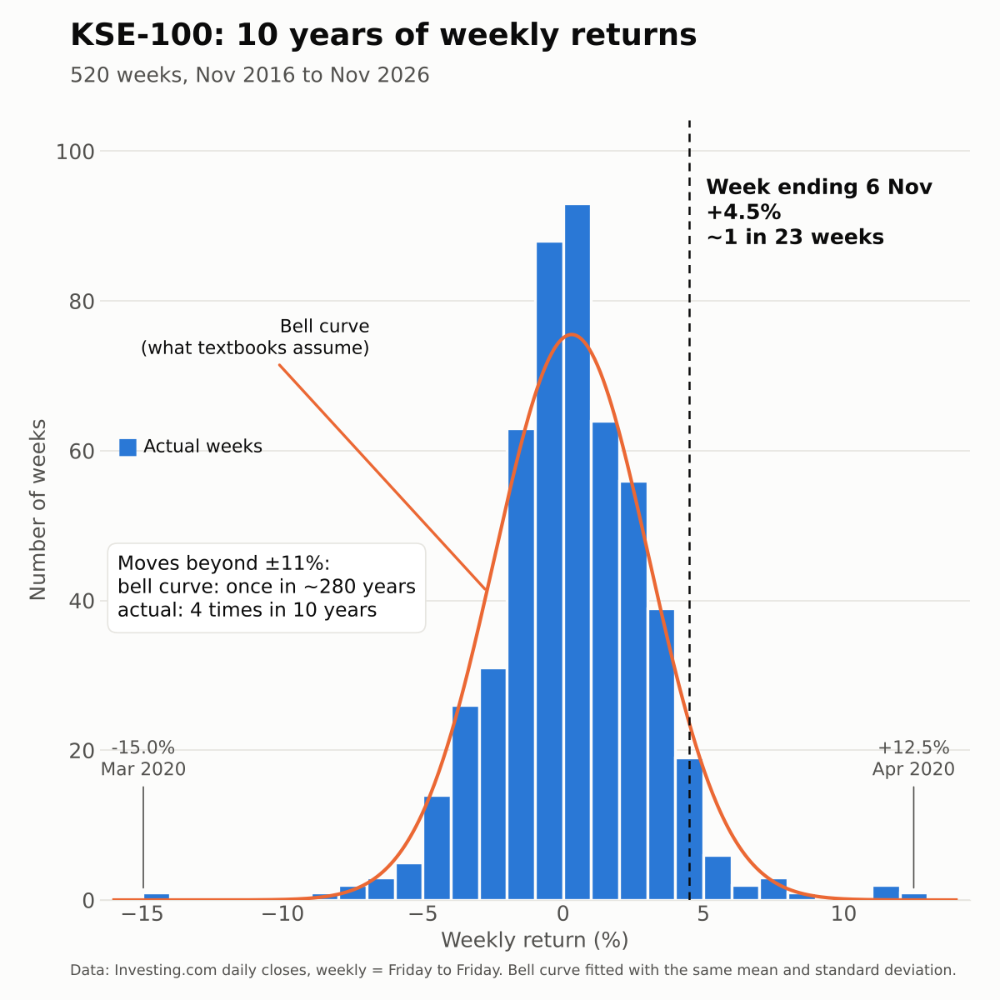

# KSE-100 fat tails: how rare was a 4.5% week?

The KSE-100 gained 4.49% in the week ending 6 November 2026, its best week in six months. This analysis checks how unusual that was, using 10 years of weekly returns, and compares the real distribution with a bell curve.



## Findings

- **The rally was ordinary.** +4.49% is the 95.6th percentile. 23 of 520 weeks were as good or better, about one every 23 weeks.
- **The extremes are not.** Weekly moves beyond ±11% happened 4 times in 10 years. A bell curve with the same mean and standard deviation expects that about once in 280 years.
- **Fat tails, thin shoulders.** Moves beyond 3 standard deviations (±8.2%) happened 4.3x more often than a bell curve predicts, while moderately large moves (2 to 3 std) happened slightly *less* often.
- Excess kurtosis is 3.2 (a bell curve is 0). The Jarque-Bera test rejects normality (p ≈ 3e-46).

| Statistic | Value |
|---|---|
| Weeks | 520 (18 Nov 2016 to 6 Nov 2026) |
| Mean weekly return | +0.31% |
| Standard deviation | 2.75% |
| Skew | -0.02 |
| Excess kurtosis | 3.15 |

## Method

1. Daily closes of the KSE-100, November 2016 to November 2026.
2. Weekly return: `r_w = P_w / P_(w-1) - 1`, where `P_w` is the last close of the Monday to Friday week. Holiday weeks use the last trading day.
3. A normal distribution is fitted with the sample mean and standard deviation, and tail counts are compared with `N × P(|Z| > k)`.

Two data-quality rules are built in:
- Rows dated today are dropped, since Investing.com shows the intraday price as today's close while the market is open.
- An unfinished final week is dropped.

## Limitations

- Weekly returns smooth out single-day shocks. The record one-day fall on 2 March 2026 (-9.57%) recovered within the same week, so it does not appear as an extreme week. Daily returns have even fatter tails.
- The bell curve here is a reference point, not a forecast model. Volatility clusters over time (calm and turbulent periods), which a single fitted distribution ignores.

## Reproduce

The data is not included because Investing.com does not allow redistribution.

1. Go to Investing.com, Karachi 100 (KSE) Historical Data.
2. Set the timeframe to Daily and the date range to 11/11/2016 to 11/11/2026, then download the CSV.
3. Save it as `data/kse100.csv` in this folder.

```bash
pip install -r ../requirements.txt
python analysis.py data/kse100.csv --week 2026-11-06
python make_chart.py data/kse100.csv --week 2026-11-06
```

Omit `--week` to analyse the latest complete week. Use `--tail 0.08` to change the tail threshold.
