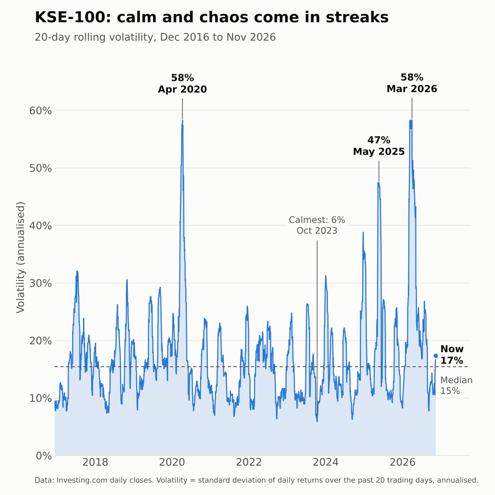

# KSE-100 volatility clustering: calm and chaos come in streaks

Daily KSE-100 returns barely predict the direction of the next day's move, but they do predict its size. Large moves tend to follow large moves, and quiet days tend to follow quiet days. This analysis measures that effect over 10 years and checks whether it survives when crisis periods are removed.



## Findings

- **Direction carries over only slightly.** The correlation between one day's return and the next is +0.08. On the PSX this is likely driven partly by stale prices (thinly traded index stocks reacting a day late) rather than tradable predictability.
- **Size carries over more strongly.** The correlation between one day's absolute return and the next is +0.19, about 2.4 times the return correlation over the full sample, and stays above +0.1 for a month (+0.11 at 20 days).
- **After one of the largest 5% of days**, the next day's move is 1.4 times larger than after other days (median, n = 123). The mean ratio is 1.8x, pulled up by crisis periods.
- **Volatility usually sits between 11% and 20%** (25th to 75th percentile of 20-day annualised volatility), with bursts to 58% in April 2020, 47% in May 2025 and 58% in March 2026. The calmest point was 5.9% in October 2023.
- **Volatility measures size, not direction.** The early November 2026 rally raised 20-day volatility from 10.5% (3 Nov) to 17.4% (10 Nov).

## Robustness

| Sample | N | Next-day corr., returns | Next-day corr., absolute returns | Lag-5 corr., absolute returns | Next-day ratio after top-5% day (median) | (mean) |
|---|---|---|---|---|---|---|
| Full sample | 2,476 | +0.082 | +0.193 | +0.212 | 1.41 | 1.76 |
| 2017-2019 | 742 | +0.148 | +0.104 | +0.140 | 1.09 | 1.08 |
| 2021-2024 | 987 | +0.099 | +0.181 | +0.131 | 1.34 | 1.50 |
| Excl. Feb-Jun 2020 and Feb-May 2026 | 2,298 | +0.116 | +0.173 | +0.110 | 1.27 | 1.61 |
| Returns scaled by past 250-day volatility | 2,226 | +0.091 | +0.178 | +0.176 | 1.46 | 1.72 |

- The size correlation is positive in every sample, including with both crises removed. Crisis days are masked rather than dropped, so the days on either side of a crisis are not paired as consecutive.
- Scaling each return by the previous year's volatility removes slow shifts between calmer and wilder eras, which can otherwise make size correlations look stronger than they are. The effect remains.
- In 2017-2019 the size correlation stays positive (+0.104), but it is lower than the direction correlation in the same period (+0.148), and the next-day ratio after large days is close to 1. Clustering was weak in that calmer period, and the full-sample result that size carries over more than direction does not hold for every sub-period.

## Method

1. Daily closes, 14 November 2016 to 10 November 2026.
2. Daily return: `r_t = P_t / P_(t-1) - 1`, where `P_t` is the closing price on trading day `t`.
3. Autocorrelation of `r_t` and of `|r_t|` at lags of 1 to 20 trading days.
4. Top-5% days: days where `|r_t|` exceeds its 95th percentile over the full sample. The next day's `|r|` is compared with the next day's `|r|` after all other days.
5. Rolling volatility: standard deviation of daily returns over the previous 20 trading days, multiplied by the square root of 248 (the average number of trading days per year in the data). Each value uses only data available on that date.

## Limitations

- This is descriptive. The top-5% threshold and the correlations use the full sample, so they describe the past rather than forecast. A forecasting test would need estimates using only data available at each date.
- Annualising by the square root of trading days assumes independent days, which this analysis shows is not strictly true. It is the standard convention for comparing volatility across periods.
- 50 of the 2,476 returns span holidays longer than a weekend and are treated as single-day returns.
- Causes of individual volatility spikes are not attributed here.

## Reproduce

The data is not included because Investing.com does not allow redistribution.

1. Go to Investing.com, Karachi 100 (KSE) Historical Data.
2. Set the timeframe to Daily and the date range to 11/14/2016 to 11/10/2026, then download the CSV.
3. Save it as `data/kse100.csv` in this folder.

```bash
pip install -r ../requirements.txt
python analysis.py data/kse100.csv --end 2026-11-10
python make_chart.py data/kse100.csv --end 2026-11-10
```

`--end` excludes rows after the given date. It is needed when a file was downloaded during market hours, because the last row is then an intraday price rather than a close.
