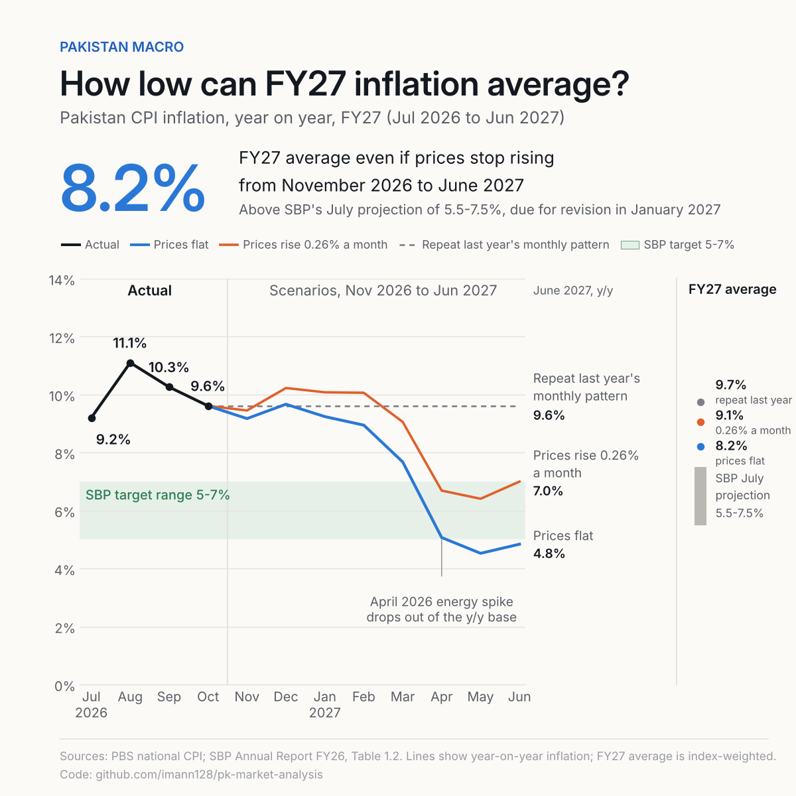

# How low can FY27 inflation average? Checking the SBP's projection

The State Bank of Pakistan's Annual Report on the State of Pakistan's Economy (FY26), released on 16 November 2026, says in its outlook (Chapter 1, section 1.2): "the SBP expects inflation to remain above the medium-term target range in FY27." Its Table 1.2 still lists an FY27 average CPI inflation projection of 5.5-7.5%, footnoted: "July's projections, based on oil price of US$ 80/bbl., as per practice, projection range will be revised in January 2027 to account for higher oil prices and other key developments." Chapter 3 records the MPC's April 2026 assessment that year-on-year inflation would "remain in double digits and exceed the upper bound of the target range for most of FY27."

Some news coverage summarised the report as expecting inflation to "gradually ease towards the medium-term target range of 5-7% during FY27." That sentence does not appear in Chapters 1 or 3.

This analysis checks what the July projection, and the target range, would require given CPI data for July to October 2026.



## Findings

- **Unless prices fall, the FY27 average cannot be below 8.2%.** July to October 2026 averaged 10.0% (SBP: 10.1%). With zero monthly inflation from November 2026 to June 2027, the FY27 average is 8.2%. Any non-negative monthly path gives a higher average.
- **The July projection of 5.5-7.5% would need sustained deflation.** With a constant monthly rate, the top of the range (7.5%) needs prices to fall 0.22% every month from November to June (1.8% in total); the bottom (5.5%) needs 0.85% a month (6.6% in total). The SBP has said this range will be revised in January 2027.
- **The report's own text agrees with the arithmetic:** inflation above the target range in FY27.
- **Reaching 7% year on year by June 2027 is a separate question.** It needs monthly inflation of about 0.26% (a 2.06% total rise from November to June). At the pre-shock pace of 0.36% a month, June 2027 would be 7.9%. If prices repeat last year's monthly pattern, inflation stays at 9.6% and the FY27 average is 9.7%; at 0.26% a month the average is 9.1%.
- **Base effects do part of the work.** April 2026's 2.48% month leaves the 12-month window in April 2027, pulling the year-on-year rate down by more than 2 points that month. December works the other way: December 2025 was -0.45%, so year-on-year inflation rises in December 2026 in every constant-rate scenario, including flat prices, unless December 2026 also falls by about as much.

| Constant MoM, Nov 2026 to Jun 2027 | Dec 2026 | Mar 2027 | Apr 2027 | Jun 2027 | FY27 average |
|---|---|---|---|---|---|
| 0.00% | 9.7% | 7.7% | 5.1% | 4.8% | 8.2% |
| 0.26% | 10.2% | 9.1% | 6.7% | 7.0% | 9.1% |
| 0.50% | 10.8% | 10.4% | 8.3% | 9.1% | 9.9% |
| 1.08% (October's pace) | 12.0% | 13.6% | 12.1% | 14.2% | 11.8% |

## Method

Year-on-year inflation rolls forward one month at a time:

```
(1 + YoY_t) = (1 + YoY_(t-1)) × (1 + MoM_t) / (1 + MoM_(t-12))
```

- `YoY_t`: year-on-year inflation in month `t`
- `MoM_t`: month-on-month change in month `t` (the scenario input)
- `MoM_(t-12)`: the same month a year earlier, leaving the window (known)

Starting from October 2026 (9.61%), each scenario applies one constant `MoM_t` from November 2026 to June 2027. The required monthly rates are solved numerically.

FY27 average inflation follows the official period-average definition: the average FY27 index divided by the average FY26 index, minus 1. This weights each month's year-on-year rate by its FY26 index level. FY26 index levels are rebuilt from the monthly changes, relative to June 2026.

Two checks:

- October 2025's index computed forwards from FY27 data (0.9567) and backwards from June 2026 (0.9565) agree.
- The derived May 2026 MoM (0.52%) matches the SBP's published 0.5%, and the July-October average (10.04%) matches the SBP's 10.1% within the rounding of the July and August inputs.

## Data

PBS national CPI (base 2015-16):

- FY27 year-on-year: July 9.2%, August 11.1%, September 10.26%, October 9.61%
- FY27 month-on-month: July 1.2%, August 1.2%, September 1.3% (SBP Inflation Monitor, October 2026), October 1.08%
- Month-on-month, November 2025 to June 2026: 0.40%, -0.45%, 0.39%, 0.27%, 1.18%, 2.48%, 0.52%, -0.30%
- May 2026 is derived from index levels (March 285.73, April = March × 1.0248, May 294.34), as the June release does not state it directly.

## Sensitivity

The June 2027 result depends only on the total price change from November to June, not on how it is spread across months. In the identity above, the eight new monthly changes multiply together. A constant 0.26% a month equals a 2.06% total rise, and any path with the same total gives 7.0% in June:

| Path with a 2.06% total rise | Jun 2027 | FY27 average |
|---|---|---|
| Even, 0.26% a month | 7.0% | 9.1% |
| Last year's seasonal shape, rescaled | 7.0% | 8.9% |
| All in November | 7.0% | 9.7% |
| All in June | 7.0% | 8.4% |

The constant-rate assumption therefore does not affect the June figures. It does affect the FY27 average, which ranges from 8.4% to 9.7% for the same total depending on timing.

At the pre-shock pace of 0.36% a month (November 2025 to March 2026), June 2027 inflation would be 7.9%, just above the range. November to March is seasonally softer than April to June (0.36% vs 0.90% average monthly change in 2026, though April includes the energy shock), so applying that pace to all of November to June is, if anything, optimistic.

## Limitations

- The scenarios separate the base effect from new price changes; they do not model what drives those changes (food, energy tariffs, the exchange rate).
- November 2025 MoM and July to September 2026 MoM are published rounded to one decimal, as are July and August 2026 year-on-year figures, so results carry roughly ±0.05 percentage points of rounding error.
- The required deflation rates for the July projection assume a constant monthly rate. The 8.2% floor does not depend on timing; the required rates for a given average do.
- This is arithmetic on published data, not a forecast, and does not assess the SBP's reasoning. The July projection predates July-October CPI data, and the SBP has said it will be revised.

## Run

```bash
python target_path.py
python make_chart.py
```
